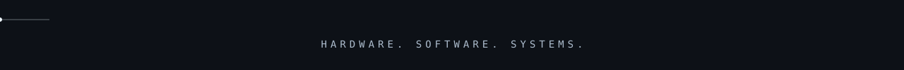

<a name="top"></a>

<p align="center">
  
</p>

<p align="center">
  
</p>

<p align="center">
  <a href="https://github.com/DemiD3mon?tab=repositories"></a>
  &nbsp;
  <a href="#workbench"></a>
  &nbsp;
  <a href="#current-focus"></a>
</p>

## ✦ About me

```yaml
name: Vian Studer
alias: DemiD3mon
based_in: Switzerland
background: Electronics / Elektroniker EFZ training
focus:
  - Electronics, measurement and embedded systems
  - Local AI and desktop applications
  - Building, testing and understanding how things work
```

Most of what I do starts with something I want to make work: a circuit, a motor, a local assistant or a tool that makes a task easier. I like the whole process: assembling it, wiring it, testing it, finding the fault and getting it running.

My projects move between **physical hardware and software**: analog measurements, microcontrollers, automation, desktop interfaces and AI that runs on my own machines.

> I learn best when I can build it, measure it and change it myself.

<a name="workbench"></a>

## ✦ Tools & technologies

<p align="center"></p>

| Electronics & hardware | Software & systems |
| :--- | :--- |
| Circuit assembly, soldering & fault finding | Local model setup & assistant workflows |
| Analog measurement, filters & op-amps | Desktop interfaces with React & Electron |
| Microcontrollers, PWM & motor control | TypeScript, C/C++ and C# projects |
| PC builds & hardware configuration | Git, application tooling & automation |

<p><strong>Explore the workbench</strong> · Open a section to see how I use the tools.</p>

<details>
<summary><strong>Electronics & hardware</strong> · Circuits, control and physical systems</summary>
<p>I work with circuit assembly, soldering, measurement and troubleshooting, as well as microcontrollers, PWM and motor control.</p>
<p><strong>On the bench:</strong> ESP32 · Raspberry Pi · C/C++ · PC hardware</p>
<p><a href="#project-alerts">See the warning-light project ↓</a> · <a href="#project-hardware">Explore FPV & PC builds ↓</a></p>
</details>

<details>
<summary><strong>Local AI & interfaces</strong> · Models, memory and desktop tools</summary>
<p>I use local models to explore personal assistants with memory, tool permissions and an interface built around everyday use.</p>
<p><strong>In the stack:</strong> Ollama · Electron · React · TypeScript · Node.js</p>
<p><a href="#project-roxy">Explore ROXY ↓</a></p>
</details>

<details>
<summary><strong>Software & diagnostics</strong> · Inspecting data and understanding systems</summary>
<p>I build desktop tools and use practical experiments to understand how systems behave, from inputs and signals to software output.</p>
<p><strong>Working with:</strong> C# / .NET · Git · Application tooling</p>
<p><a href="#project-spectre">Explore SPECTRE ↓</a></p>
</details>

<a name="things-i-build"></a>

## ✦ Things I build

<p><a href="#project-roxy">ROXY</a> · <a href="#project-alerts">Warning system</a> · <a href="#project-spectre">SPECTRE</a> · <a href="#project-hardware">FPV & PC builds</a></p>

<table>
<tr>
<td width="50%" valign="top">
<a name="project-roxy"></a>
<h3>ROXY / Local AI assistant</h3>
<p>A personal desktop assistant with local models, memory, permission-controlled tools and an animated interface.</p>
<p><strong>Working with:</strong> Electron · React · TypeScript · Ollama</p>
<p><sub>Software project · Private repository</sub></p>
<details>
<summary>Explore the local assistant</summary>
<p>Your input enters the desktop interface, which connects to a local model. Memory and permission-controlled tools support the assistant workflow.</p>
<p></p>
<p><a href="#workbench">Back to the workbench ↑</a></p>
</details>
</td>
<td width="50%" valign="top">
<a name="project-alerts"></a>
<h3>Service-ticket warning system</h3>
<p>Connecting software events to a physical warning light, with a local event emulator and Raspberry Pi integration.</p>
<p><strong>Working with:</strong> Raspberry Pi · JSON · Webhooks · Hardware I/O</p>
<p><sub>Automation project · Prototype work</sub></p>
<details>
<summary>Follow the signal to the warning light</summary>
<p>A software event reaches the Raspberry Pi, which connects the event workflow to a switched physical warning output.</p>
<p></p>
<p><a href="#workbench">Back to the workbench ↑</a></p>
</details>
</td>
</tr>
<tr>
<td width="50%" valign="top">
<a name="project-spectre"></a>
<h3>SPECTRE / Security workbench</h3>
<p>A Windows desktop project for security learning, diagnostics and inspecting data through one interface.</p>
<p><strong>Working with:</strong> C# · .NET · WPF · Local AI</p>
<p><sub>Software project · Private repository</sub></p>
<details>
<summary>Open the workbench workflow</summary>
<p>A local workspace brings together inspection tools and diagnostic results, with notes for keeping track of findings.</p>
<p></p>
<p><a href="#workbench">Back to the workbench ↑</a></p>
</details>
</td>
<td width="50%" valign="top">
<a name="project-hardware"></a>
<h3>FPV & PC hardware</h3>
<p>Built a 4S FPV drone and custom PCs. I enjoy choosing components, putting systems together and making them work.</p>
<p><strong>Working with:</strong> Assembly · Wiring · Configuration · Testing</p>
<p><sub>Personal builds · Hands-on hardware</sub></p>
<details>
<summary>Explore the build process</summary>
<p>Component selection, assembly, wiring, configuration and testing are all part of making a physical build work.</p>
<p></p>
<p><a href="#workbench">Back to the workbench ↑</a></p>
</details>
</td>
</tr>
</table>

## ✦ Practical background

**Electronics / Elektroniker EFZ training · Switzerland**

- Assembling, wiring and testing electronic systems.
- Soldering, measuring and tracing hardware faults.
- Working with control circuits, motors and microcontrollers.
- Connecting software interfaces to real devices and signals.
- Building and configuring PCs, with a growing interest in self-hosted systems.

<a name="beyond-the-workbench"></a>

## ✦ Beyond the workbench

**Game development / Learning:** Exploring Unreal Engine and dark-fantasy world building, from terrain and scale to the feel of a space.

<a name="current-focus"></a>

## ✦ Current focus

```yaml
building:
  - More useful local AI tools, memory and interfaces
  - Hardware integration and practical automation

exploring:
  - Self-hosting and Fedora KDE
  - Unreal Engine and interactive worlds
  - Motion and interface design
```

<a name="activity"></a>

## ✦ Activity

Public GitHub activity only tells part of the story. A lot of my work happens on a workbench, in private projects or while testing hardware.

<details>
<summary>Open contribution snake</summary>
<br>

</details>

---

<p align="center"><a href="#top">Back to top ↑</a> &nbsp; · &nbsp; <a href="#workbench">Workbench</a> &nbsp; · &nbsp; <a href="#activity">Activity</a> &nbsp; · &nbsp; <a href="https://github.com/DemiD3mon">GitHub / Vian Studer</a> &nbsp; · &nbsp; <a href="https://github.com/DemiD3mon?tab=repositories">Explore repositories</a></p>
<p align="center"></p>
